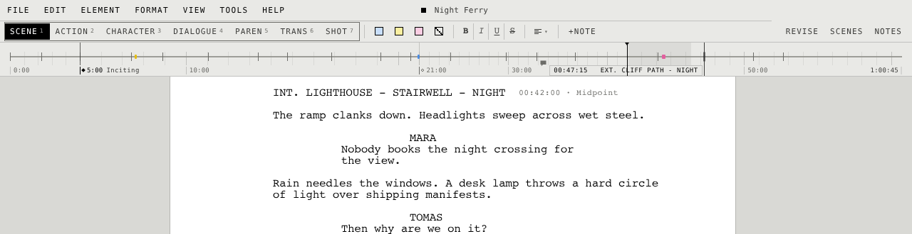

  

<h1 align="center">STET</h1>

<b>A calm, fast place to write your screenplay.</b> 
It formats as you type, saves as you go, and stays out of your way.

  <a href="https://github.com/mediocrecode56/stet-screenwriter/releases/latest/download/STET-Windows.zip"><b>Download for Windows</b></a>
  &nbsp;·&nbsp;
  <a href="https://github.com/mediocrecode56/stet-screenwriter/releases/latest/download/STET-macOS.dmg"><b>Download for Mac</b></a>
  &nbsp;·&nbsp;
  <a href="CHANGELOG.md">What's new</a>

Free · Windows 10 and 11 · Macs with Apple silicon (M1 or later), macOS 12 or later

  

## Why STET

| | |
|---|---|
| **It formats itself** | Press Enter and Tab: scene headings, characters, dialogue and transitions fall into the standard layout, on pages that match Final Draft's. |
| **Your work is always safe** | Saved as you type, backed up on a schedule, and brought back if the computer shuts down unexpectedly. |
| **The whole script at a glance** | A timeline above the page shows every scene, note and highlight, with an estimated running time you can pin to real timecodes. |
| **A goal for every day** | Daily and weekly goals, a week of progress at a glance, and a writing streak to keep going. |
| **Spelling that stays out of the way** | Obvious slips get a thin pale red underline; right-click for the fix, or let Auto correct them as you type. It uses the dictionaries already on your computer. |
| **Day or night** | A light page, a dark one, or both, switching by themselves at the times you choose. |
| **Comes in, goes out** | Imports Final Draft (.fdx) scripts; prints or saves a PDF with the title page, ready to send. |

  
  

**A little companion.** A tiny pixel dinosaur lives on the status bar and keeps you company. It
naps when you're idle, livens up when you write, reacts when you click it, watches the weather
roll by, and grows a pixel with every milestone of your streak. It has no shame either: now and
then it scratches its back in the dust, struts about, burps after a snack or photobombs a palm
tree. Mice, lizards and bunnies dart out of the grass that grows while you're away (it chases them,
never with any luck), and after a very long break rarer plants come up. Some days it crumples up a page of its own and tosses it over its shoulder, laps at a
puddle after the rain, or settles down with a stick to chew. You can hide it from the View menu.

**A second pair of eyes (optional).** If you use Claude, it can read your dialogue and action and
suggest fixes to the English. Nothing in the script changes until you accept a suggestion.

## Get started

<b>Windows</b>

1. Download **STET-Windows.zip** and open it.
2. Drag **STET.exe** to your Desktop, or any folder you like.
3. Double-click **STET.exe**. The very first start takes a few seconds; after that it opens
   straight away.

If Windows says *"Windows protected your PC"*, click **More info**, then **Run anyway**. You only
need to do this once. To open screenplays with a double-click, choose **Help → Open .stet Files
with STET**.

Prefer a regular install? The
[installer](https://github.com/mediocrecode56/stet-screenwriter/releases/latest/download/STET-Setup.exe)
adds STET to the Start menu, opens screenplays with a double-click, and can be removed from
Settings → Apps.

<b>Mac</b>

1. Download **STET-macOS.dmg** and open it.
2. Drag **STET** to the **Applications** folder.
3. Open STET from Applications.

If macOS says it can't check STET for malware, click **Done**, open **System Settings → Privacy &
Security**, scroll down and click **Open Anyway** next to STET. You only need to do this once.

**Updating** is built in. When there is a new version, **UPDATE** appears at the bottom right:
click it, then **Update now**. STET downloads it while you keep writing (usually about a megabyte)
and asks to restart when it's ready. Your screenplays, settings and statistics stay as they are.

## Spelling

The **SPELLING** menu on the toolbar switches spelling on or off and picks the language from the
dictionaries installed on your computer (those LibreOffice, Firefox or your system installed; on
a Mac, its own). Only obvious slips are marked, with a thin pale red underline: names, all-caps
words and scene headings are left alone. Right-click a marked word for the fix, or to add it to
your dictionary or ignore it in this script; STET remembers both (Tools > Dictionary & Ignored
lists them). With **Auto** on, the same slips are corrected as you press Space, and Ctrl+Z
takes a correction back. No dictionary on your computer? **Install Dictionary** in the same menu
downloads one in the background (and **Add a Language** any other), with a notice when it's ready.

## The timeline

The strip under the toolbar is your whole screenplay from left to right, like a track in a video
editor: a tick for each scene, your highlights in their colours, an icon for each note, and a time
ruler with the estimated running time at the right end. The shaded band is the part on screen; the
line with the cap is where you're typing. **Ctrl+Shift+T** shows or hides it.

- **Point** at it to see the time and the scene there; **click** to go there.
- **Drag sideways** to zoom around that point, **drag the shaded band** to scroll, and
  **double-click the ruler** to see the whole script again.
- **Timecodes** set the clock. The ruler counts a minute a page until you pin real times; then it
  spreads the time between them. **Right-click a scene** to give it its own timecode, shown beside
  its heading; right-click anywhere else to add one there; click one to change it. The **check**
  (or Enter) keeps it and the **bin** removes it; click away and nothing changes.
- The **scene list** (Ctrl+\\) shows each scene at its time; right-click a scene there for its
  timecode too. Drag the inner edge of the scene list, the notes or the revision panel to widen it;
  the **lock** beside REVISE keeps them as they are.
- Scenes, notes and highlights sit on **whole seconds**, never between two.
- **Hold Ctrl** (**Cmd** on a Mac) over the strip to step through the script a second at a time.
  Only the script moves: the pointer stays put and your caret stays where it was, so nothing else
  in the window reacts. **Click** to put the caret there; a **right-click** pins a timecode at that
  second. Let go to stay there, or press **Esc** to go back.

## Handy keys

| Press | To |
|---|---|
| Enter | move on to the next line: after a character, their dialogue |
| Tab | start a different kind of line (Ctrl+click a type in the toolbar to leave it out) |
| Ctrl+S | save (STET also saves by itself) |
| Ctrl+F | find |
| Ctrl+P | print or save as PDF |
| Ctrl+Shift+T | show or hide the timeline |
| F9 | see your writing week |
| Ctrl+K | search every command |
| F1 | see all the keys, and change any of them |

On a Mac, use Cmd where it says Ctrl.

## Good to know

- Screenplays are saved as `.stet` files, in **Documents/STET** unless you choose another place.
- Pages are A4 and look like Final Draft's: the same Courier, spacing, margins and page breaks.
- STET is young and improving often: see [what's new](CHANGELOG.md).

Building or changing STET? See [STET for developers](docs/DEVELOPING.md).
