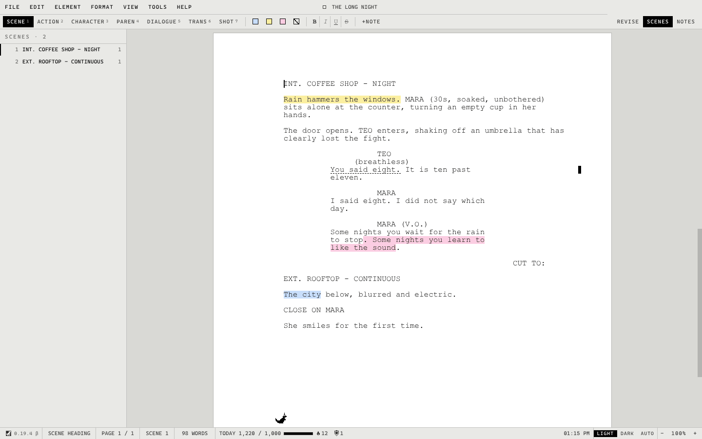
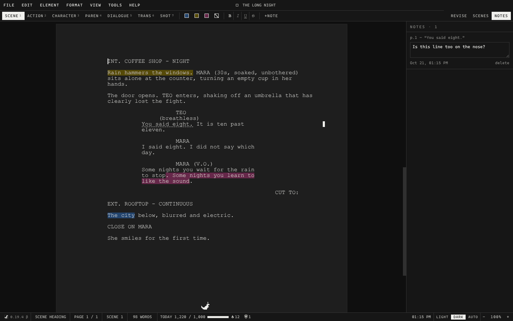
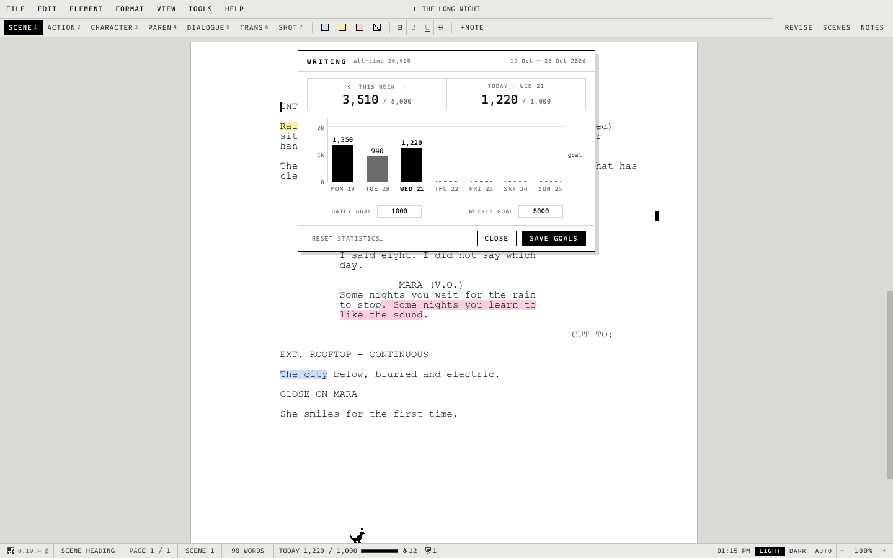
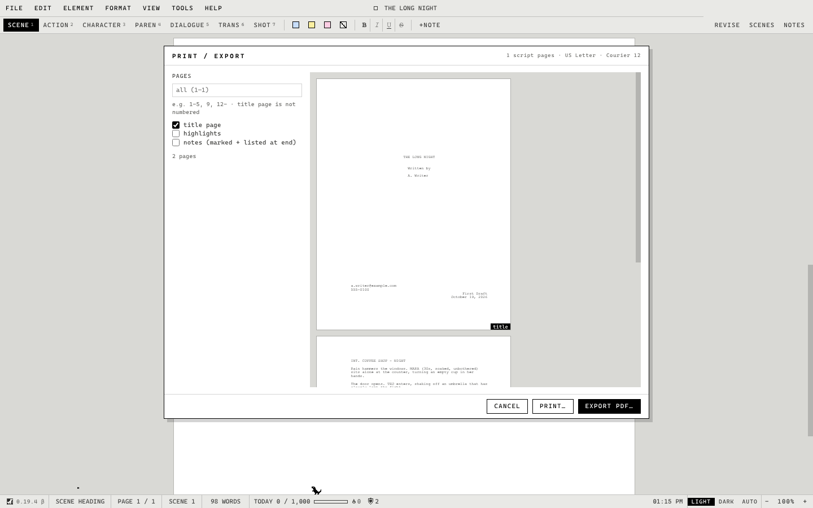

# STET

A calm, simple place to write your screenplay.

### [Download STET for Windows](https://github.com/mediocrecode56/stet-screenwriter/releases/latest/download/STET-Windows.zip)

Free. For Windows 10 and 11. Nothing to install.

## Get started

1. Download **STET-Windows.zip** with the link above.
2. Open the zip and drag **STET.exe** to your Desktop, or any folder you like.
3. Double-click **STET.exe**. The very first start takes a few seconds; after
   that it opens straight away.

Windows may say *"Windows protected your PC"* because STET is a new app it
doesn't know yet. Click **More info**, then **Run anyway**. You only need to do
this once.

**Updating:** STET checks for a new version when it opens. When there is one,
**UPDATE** appears at the bottom right: click it, then **Update now**. STET
downloads it while you keep writing and asks to restart when it's ready. Your
screenplays, settings and writing statistics stay just as they are. You can also
check any time under **Help → Check for Updates**.

**Prefer a regular install?** Download the
[installer](https://github.com/mediocrecode56/stet-screenwriter/releases/latest/download/STET-Setup.exe)
instead. It adds STET to your Start menu, lets you open screenplays with a
double-click, and can be removed from Settings → Apps. It updates the same way,
from inside STET.

## What it's like

**Just write; it formats itself.** Press Enter and Tab, and scene headings,
characters and dialogue fall into place in the standard screenplay layout.

**Your work is always safe.** STET saves as you type, keeps backups, and brings
back anything unsaved if your computer shuts down unexpectedly.

**Day or night.** A light page for the day, a dark one for the evening, or let
STET switch by itself at the times you choose.

**Notes and highlights.** Leave yourself a note on any line, mark passages in
colour, and jump between scenes from the scene list.

**A goal for every day.** Set how much you want to write each day and each week,
watch your week fill up, and keep a streak going.

**A little companion.** A tiny dinosaur lives at the bottom of the window and
keeps you company while you write. It grows as your streak does. You can hide
it from the View menu.

**Print and PDF.** Print your screenplay or save it as a PDF, title page
included, ready to send.

**A second pair of eyes (optional).** If you use Claude, it can read through
your dialogue and action and suggest fixes to the English. Nothing changes
until you accept.

## Handy keys

| Press | To |
|---|---|
| Enter | move on to the next line: after a character, their dialogue |
| Tab | change what kind of line you're on |
| Ctrl+S | save (STET also saves by itself) |
| Ctrl+F | find |
| Ctrl+P | print or save as PDF |
| F9 | see your writing week |
| Ctrl+K | search every command |
| F1 | see all the keys |

## Good to know

- Screenplays are saved as `.stet` files, in your **Documents\STET** folder
  unless you choose another place.
- Pages are US Letter size.
- STET is young and improving often. See [what's new](CHANGELOG.md).

---

Building or changing STET? See [STET for developers](docs/DEVELOPING.md).
